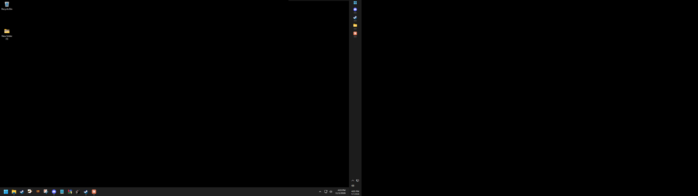

# AST: Additional Screen Taskbars

Windows 11 can't give each screen its own taskbar position. AST adds a separate taskbar to your other screens, and each screen can have its own setting.

[](https://github.com/Gnawbie/additional-screen-taskbars/releases/download/v0.1.3/ASTSetup.exe)



*The Windows taskbar on the main screen, with an AST bar on the side of the second screen.*

## Features

- Put a bar on the top, bottom, left or right of each screen, or turn it off for that screen
- Drag an empty part of a bar to another edge of its screen
- Resize a bar by dragging its inner edge, or with the slider in Options
- Right-click a bar and choose **Lock taskbars** to stop dragging from moving or resizing it
- Show icons only (the default), or right-click a bar and choose **Show program names**
- List programs from all screens (the default), or right-click a bar and untick **Show programs from all screens** to list only that screen's programs
- Show program names vertically on side bars
- Right-click a bar and choose **Show pinned programs** to also list what's pinned to the Windows taskbar, in the same order
- Right-click a program to pin or unpin it, run it as administrator or open its file location. Windows doesn't let other programs change its taskbar, so these pins apply to AST's bars only
- Tray buttons for hidden icons, network and volume, with live status
- Choose the Modern or Classic look, or add your own (see [docs/MODDING.md](docs/MODDING.md))
- Bars hide when a fullscreen or borderless program covers their screen, even if it loses focus. To keep them showing, right-click a bar and untick **Hide for fullscreen programs**

AST uses the documented Windows app bar API. It doesn't inject code into Explorer or games, and it doesn't hook the keyboard.

## Replacing the Windows taskbar (experimental)

Set your main screen to any edge in Options, and its AST bar replaces the Windows taskbar until you set that screen back to Off. AST also starts with Windows from then on. Windows has no supported way to remove its taskbar, so AST turns on its auto-hide and makes it fully see-through. So that you're never left without a taskbar, it comes back whenever AST closes, and a small guard process restores it if AST is forced to close.

If the taskbar ever stays hidden, run:

```bash
"%LOCALAPPDATA%\Programs\AST\AST.exe" --restore-taskbar
```

Restarting Explorer also brings it back, though it may stay on auto-hide until you run that command or change the setting in Settings > Personalization > Taskbar.

## Install

Run `ASTSetup.exe`. It installs for the current user, needs no admin rights and uses the .NET Framework built into Windows 10 and 11. AST starts with Windows by default, which you can turn off in Options.

The exe isn't code-signed yet, so Windows SmartScreen may warn about it.

To remove AST, go to Settings > Apps > Installed apps.

## Use

Your main screen starts with no bar, because the Windows taskbar is there. Other screens start with a bar at the bottom. Turning on a bar for your main screen replaces the Windows taskbar (see below).

To open Options, right-click a bar and choose **Options...**, or click the AST tray icon. Use **Identify screens** to see each screen's number. Numbers come from the Windows display name, such as `\\.\DISPLAY2`, and normally match Settings > System > Display.

Command line options: `--install`, `--uninstall`, `--silent`, `--settings`, `--quit`, `--restore-taskbar`.

## Build

You need Visual Studio or the VS Build Tools with a .NET Framework 4.7.1 or later targeting pack.

```bash
powershell -ExecutionPolicy Bypass -File build.ps1
```

The output goes to `dist\`.

## Known limits

- No jump lists of recent files, thumbnail previews or flashing buttons for windows that want attention
- Tray buttons mirror the Windows taskbar's and open Windows' own flyouts, moved to the bar's screen just after they open
- Other programs' tray icons, such as Discord's, stay in the hidden icons flyout rather than on the bar
- Windows chooses which screen the Start menu opens on
- A store app may show a generic icon

## License

AST is freeware. You can use, copy, share and modify it for free, but you can't sell it. See the [license](LICENSE), which is the MIT License with the Commons Clause.
